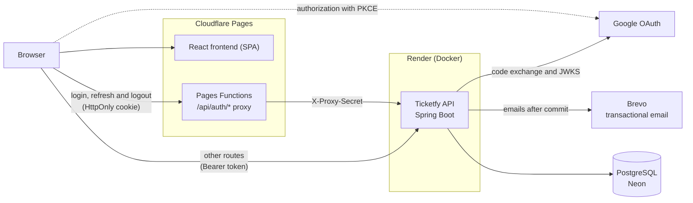

# Ticketfy API

REST API for selling event tickets, built with Java and Spring Boot: from ticket tiers to sales, from QR Code to check-in.

<p align="center">
  <a href="https://ticketfy-6fd.pages.dev"></a>
</p>

<p align="center"><sub><a href="README.md">Ler em português</a></sub></p>

<table>
  <tr>
    <td width="33%"><br><sub>Home page</sub></td>
    <td width="33%"><br><sub>Event and ticket selection</sub></td>
    <td width="33%"><br><sub>Order review</sub></td>
  </tr>
  <tr>
    <td><br><sub>Tickets with QR Code</sub></td>
    <td><br><sub>Organizer dashboard</sub></td>
    <td align="center"><br><sub>On a phone</sub></td>
  </tr>
</table>

<sub>Local frontend with the fictional events from <code>scripts/seed-demo.sh</code> and simulated payment. The interface is shown in Portuguese and is also available in English.</sub>

## About

Selling tickets is easy until two people fight over the last seat, someone double-clicks "pay" or the same QR Code is scanned at two gates. Ticketfy handles these cases in the database, with transactions and locks, for three roles: buyer, organizer and administrator.

## Features

- **Buyer:** search by name, city and category; checkout with coupons and a 15-min reservation; tickets with QR Code and `.ics`; transfers, refunds, Google sign-in and account export or deletion.
- **Organizer:** events, ticket tiers and coupons; check-in and attendee list; sales dashboard; cancellation with automatic refunds; ledger and payouts.
- **Admin:** payout review, account suspension, featured events and audit log.

## Technical highlights

- **Last ticket:** the reservation is a single conditional `UPDATE` on the stock, tested with 10 threads competing for the same tier.
- **Session:** 10-min access token and a rotating refresh token in an `HttpOnly` cookie; token reuse revokes the session (with a 30 s tolerance).
- **Google sign-in:** authorization code with PKCE, code exchanged on the server and `id_token` validated through JWKS.
- **Password reset:** 256-bit, single-use, 30-min token stored only as SHA-256.
- **Emails after commit:** `@TransactionalEventListener(AFTER_COMMIT)` on its own queue; a rolled-back purchase never sends an email.
- **3.6x faster startup:** AppCDS and C1-only JIT cut startup from 516 s to 142 s on 0.1 CPU.

All 27 decisions, with reasoning and consequences, are in the [architecture document](docs/05%20-%20Documento%20de%20Arquitetura.md#9-decisões-arquiteturais) (in Portuguese).

## Stack

Java 17, Spring Boot 4.1.1, Spring Security 7.1, Hibernate 7.4, PostgreSQL 16, Flyway 12.4, JUnit 6, Testcontainers 2.0 and JaCoCo, with Docker, GitHub Actions, Render and Neon. Frontend in React 19, Vite 8, TypeScript 7 and Tailwind 4 on Cloudflare Pages.

## Architecture



## Quality

608 tests (59 integration test classes on a real PostgreSQL via Testcontainers), 95% coverage, and CI running the tests and minimum coverage on every push, plus CodeQL and Dependabot.

## Running locally

Requires Java 17+ and Docker. Create a `.env` with `DB_PASSWORD` and `JWT_SECRET` (32+ characters) and run:

```bash
docker compose up -d
set -a; source .env; set +a
./mvnw spring-boot:run          # API at http://localhost:8080, Swagger at /swagger-ui/index.html
./mvnw verify                   # tests (needs Docker)
```

For demo data, use an organizer account: `TICKETFY_EMAIL=... TICKETFY_PASSWORD=... scripts/seed-demo.sh`.

<details>
<summary>Environment variables</summary>

| Variable | Purpose |
|---|---|
| `DB_URL`, `DB_USERNAME`, `DB_PASSWORD` | PostgreSQL connection (`DB_PASSWORD` required) |
| `JWT_SECRET` | Access token signing (required) |
| `SPRING_PROFILES_ACTIVE` | `dev` or `prod` profile |
| `PAYOUT_ENCRYPTION_KEY`, `PROXY_SHARED_SECRET` | Encryption of tax ID and Pix key, and the frontend proxy secret (required in `prod`) |
| `CORS_ALLOWED_ORIGINS`, `SITE_BASE_URL` | Allowed frontend origins and the site address used in emails and `.ics` |
| `GOOGLE_CLIENT_ID`, `GOOGLE_CLIENT_SECRET`, `GOOGLE_REDIRECT_URIS` | Google sign-in |
| `BREVO_API_KEY`, `MAIL_FROM_EMAIL`, `MAIL_FROM_NAME` | Email sending (without them, sends are only logged) |
| `LOGIN_*`, `COUPON_*`, `PAYOUT_*` and others | Limits, deadlines and fees, all with defaults |

The full list is in the [Config](docs/05%20-%20Documento%20de%20Arquitetura.md#config) section of the architecture document.

</details>

## Development

Built by me with the help of AI (Claude Code); the decisions, reviews and testing were carried out by me.

## Author

**Rodrigo Lutfy** · [GitHub](https://github.com/rodrigolutfydev) · [rodrigolutfy.dev@gmail.com](mailto:rodrigolutfy.dev@gmail.com)

## Links

- [Website](https://ticketfy-6fd.pages.dev)
- [Frontend repository](https://github.com/rodrigolutfydev/ticketfy-web)
- [API documentation](docs/API.md)
- [openapi.json](docs/openapi.json)
- [Architecture document](docs/05%20-%20Documento%20de%20Arquitetura.md)
- [Versão em português](README.md)
