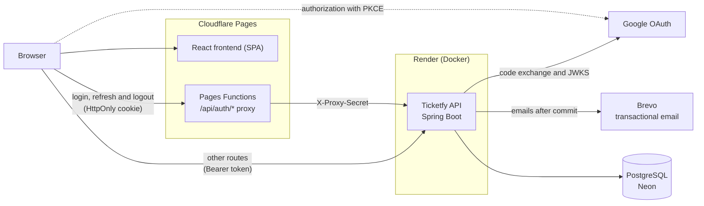

[](https://github.com/rodrigolutfydev/Ticketfy-API/actions/workflows/ci.yml) [](https://rodrigolutfydev.github.io/Ticketfy-API/jacoco/) [](https://github.com/rodrigolutfydev/Ticketfy-API/actions/workflows/codeql.yml) [](LICENSE)

# Ticketfy API

<p>Website: <a href="https://ticketfy-6fd.pages.dev">ticketfy-6fd.pages.dev</a><br><sub><a href="README.md">Português</a></sub></p>

REST API for selling event tickets, built in Java with Spring Boot.

<table>
  <tr>
    <td width="33%"><br><sub>Home page</sub></td>
    <td width="33%"><br><sub>Event and ticket selection</sub></td>
    <td width="33%"><br><sub>Order review</sub></td>
  </tr>
  <tr>
    <td><br><sub>Tickets with QR Code</sub></td>
    <td><br><sub>Organizer dashboard</sub></td>
    <td align="center"><br><sub>Mobile version</sub></td>
  </tr>
</table>

<sub>Screens of the frontend running locally, with the fictional events from <code>scripts/seed-demo.sh</code> and simulated payment. The interface is shown in Portuguese and is also available in English.</sub>

## Contents

1. [Overview](#1-overview)
2. [Features](#2-features)
3. [Architecture](#3-architecture)
4. [Technologies](#4-technologies)
5. [Technical decisions](#5-technical-decisions)
6. [Quality](#6-quality)
7. [Running locally](#7-running-locally)
8. [Documentation](#8-documentation)
9. [Authorship](#9-authorship)

## 1. Overview

Ticketfy covers the full ticket sales cycle: event publishing, checkout, ticket issuing with QR Code, check-in and payouts to the organizer. Concurrency cases (two buyers competing for the last ticket, a double click on payment, the same ticket scanned at two gates) are handled in the database, with transactions and locks.

## 2. Features

| Role | Capabilities |
|---|---|
| Buyer | Search by name, city and category; checkout with coupons and a 15-minute reservation; tickets with QR Code and `.ics` file; transfers, refunds, Google sign-in, account export and deletion |
| Organizer | Events, ticket tiers and coupons; check-in and attendee list; sales dashboard; cancellation with automatic refunds; ledger and payouts |
| Administrator | Payout review, account suspension, featured events and audit log |

## 3. Architecture



Layered monolith (controller, service, repository) organized by domain. Session routes go through a proxy on the site's own domain, so the refresh token cookie does not depend on third-party cookies.

## 4. Technologies

| Layer | Technology | Version | Purpose |
|---|---|---|---|
| Backend | Java | 17 | API language |
| Backend | Spring Boot | 4.1.1 | Application base, REST and scheduled jobs |
| Backend | Spring Security | 7.1.1 | Authentication, roles and session filters |
| Backend | java-jwt | 4.6.0 | JWT access token |
| Backend | Nimbus JOSE | 10.9.1 | Google `id_token` validation |
| Backend | springdoc-openapi | 3.1.0 | Swagger and the `openapi.json` contract |
| Backend | ZXing | 3.5.3 | Ticket QR Codes in emails |
| Backend | Maven | 3.9.16 | Build and dependencies |
| Database | PostgreSQL | 16 | Relational database (Neon in production) |
| Database | Hibernate | 7.4.5 | Object-relational mapping (JPA) |
| Database | Flyway | 12.4.0 | Versioned migrations |
| Frontend | React | 19.3.0 | Website UI |
| Frontend | React Router | 8.4.0 | Routing |
| Frontend | TanStack Query | 5.104.0 | API calls and caching |
| Frontend | TypeScript | 7.0.2 | Typing |
| Frontend | Vite | 8.3.2 | Dev server and build |
| Frontend | Tailwind CSS | 4.3.3 | Styling |
| Infrastructure | Docker | — | Multi-stage image with AppCDS |
| Infrastructure | Render | — | API hosting |
| Infrastructure | Neon | — | Managed PostgreSQL |
| Infrastructure | Cloudflare Pages | Wrangler 4.149.0 | Frontend hosting and session proxy |
| Infrastructure | GitHub Actions | — | Continuous integration and coverage report |
| Testing | JUnit | 6.0.3 | API tests |
| Testing | Testcontainers | 2.0.5 | Real PostgreSQL in integration tests |
| Testing | JaCoCo | 0.8.15 | Coverage with a minimum enforced by the build |
| Testing | Vitest | 5.0.3 | Frontend tests |
| Testing | CodeQL and Dependabot | — | Security analysis and dependency updates |
| Integrations | Google OAuth | 2.0 | Google sign-in (authorization code + PKCE) |
| Integrations | Brevo | API v3 | Transactional emails with QR Code and `.ics` |

## 5. Technical decisions

| Topic | Implementation |
|---|---|
| Sale of the last ticket | Reservation in a single conditional `UPDATE` on the stock, tested with 10 threads competing for the same tier |
| Session | 10-minute access token and rotating refresh token in an `HttpOnly` cookie; token reuse revokes the session, with a 30-second tolerance |
| Google sign-in | Authorization code with PKCE, code exchanged on the server and `id_token` validated through JWKS |
| Password reset | 256-bit, single-use token valid for 30 minutes, stored only as a SHA-256 hash |
| Transactional email | Sent after commit (`@TransactionalEventListener(AFTER_COMMIT)`) on its own queue; a rolled-back transaction sends no email |
| Startup | AppCDS and C1-only compilation cut startup from 516 s to 142 s (3.6x) on 0.1 CPU |

All 27 architectural decisions, with reasoning and consequences, are in the [architecture document](docs/05%20-%20Documento%20de%20Arquitetura.md#9-decisões-arquiteturais) (in Portuguese).

## 6. Quality

| Item | Status |
|---|---|
| Tests | 531, including 59 integration test classes on a real PostgreSQL via Testcontainers |
| Coverage | 95% (build minimum: 92% of lines and 78% of branches) |
| Continuous integration | Tests and coverage on every push and pull request; CodeQL and Dependabot |

## 7. Running locally

Prerequisites: Java 17 or newer and Docker. Create a `.env` file with `DB_PASSWORD` and `JWT_SECRET` (at least 32 characters).

```bash
docker compose up -d
set -a; source .env; set +a
./mvnw spring-boot:run          # API at http://localhost:8080
./mvnw verify                   # tests (requires Docker)
```

Demo data, using an organizer account:

```bash
TICKETFY_EMAIL=... TICKETFY_PASSWORD=... scripts/seed-demo.sh
```

<details>
<summary>Environment variables</summary>

| Variable | Purpose |
|---|---|
| `DB_URL`, `DB_USERNAME`, `DB_PASSWORD` | PostgreSQL connection (`DB_PASSWORD` required) |
| `JWT_SECRET` | Access token signing (required) |
| `SPRING_PROFILES_ACTIVE` | `dev` or `prod` profile |
| `PAYOUT_ENCRYPTION_KEY`, `PROXY_SHARED_SECRET` | Encryption of tax ID and Pix key, and the frontend proxy secret (required in `prod`) |
| `CORS_ALLOWED_ORIGINS`, `SITE_BASE_URL` | Allowed origins and the site address used in emails and `.ics` |
| `GOOGLE_CLIENT_ID`, `GOOGLE_CLIENT_SECRET`, `GOOGLE_REDIRECT_URIS` | Google sign-in |
| `BREVO_API_KEY`, `MAIL_FROM_EMAIL`, `MAIL_FROM_NAME` | Email sending (without them, sends are only logged) |
| `LOGIN_*`, `COUPON_*`, `PAYOUT_*` and others | Limits, deadlines and fees, all with defaults |

The full list is in the [Config](docs/05%20-%20Documento%20de%20Arquitetura.md#config) section of the architecture document.

</details>

## 8. Documentation

The documents are written in Portuguese, except this README's English version.

### 8.1 Access

| Resource | Description |
|---|---|
| [Website](https://ticketfy-6fd.pages.dev) | Application in production |
| [Swagger](https://ticketfy-api.onrender.com/swagger-ui/index.html) | API endpoints in read-only mode ("Try it out" runs GET requests only) |

### 8.2 API reference

The [API reference](docs/API.md) documents the usage rules and every endpoint, grouped by subject.

| Section | Contents |
|---|---|
| [Authentication](docs/API.md#autenticação) | Access token, refresh token cookie, `Origin` and `X-Ticketfy-Auth` headers, Google sign-in, password reset and confirmation |
| [Errors](docs/API.md#erros) | RFC 7807 format, per-field validation codes, `reason` values and the table of error types |
| [CSV format](docs/API.md#formato-dos-csvs) | Separator, decimals and dates according to the account language |
| [Pagination and sorting](docs/API.md#paginação-e-ordenação) | `page`, `size` and `sort` parameters and the paged response format |
| [Idempotency](docs/API.md#idempotência) | The `Idempotency-Key` header on orders and payouts |
| [Rate limits](docs/API.md#limites-de-tentativas) | Limits per IP, user or email and 429 responses |
| [Endpoints](docs/API.md#endpoints) | Users and account, privacy (LGPD), events, ticket tiers, coupons, orders and payment, tickets and transfers, attendees, organizer dashboard and finance, administration and health |

Files generated from the code on every build and checked in CI:

| File | Contents |
|---|---|
| [`openapi.json`](docs/openapi.json) | OpenAPI 3.1 contract with 58 paths and 70 operations |
| [`problem-types.json`](docs/problem-types.json) | The 90 error types, with status, title and possible reasons |
| [`event-categories.json`](docs/event-categories.json) | The 11 event categories accepted by the API |

### 8.3 Engineering

| Document | Contents |
|---|---|
| [01 - Vision Document](docs/01%20-%20Documento%20de%20Vis%C3%A3o.md) | Problem, goals, audience and scope |
| [02 - Requirements Document](docs/02%20-%20Documento%20de%20Requisitos.md) | Functional and non-functional requirements, business rules and traceability |
| [03 - Use Case UC01](docs/03%20-%20Caso%20de%20Uso%20UC01%20-%20Compra%20de%20Ingresso.md) | Ticket purchase: main, alternative and exception flows |
| [04 - Domain Class Diagram](docs/04%20-%20Diagrama%20de%20Classes%20de%20Dom%C3%ADnio.md) | Classes, attributes, enums and cardinalities |
| [05 - Architecture Document](docs/05%20-%20Documento%20de%20Arquitetura.md) | Layers, request flow, security, observability, persistence, architectural decisions and limitations |

### 8.4 Project

| Document | Contents |
|---|---|
| [Roadmap](docs/ROADMAP.md) | What has been delivered and the next steps |
| [Versão em português](README.md) | This document in Portuguese |

## 9. Authorship

Developed by Rodrigo Lutfy with the help of AI (Claude Code); the decisions, reviews and testing were carried out by the author.

Contact: [rodrigolutfy.dev@gmail.com](mailto:rodrigolutfy.dev@gmail.com) · GitHub: [rodrigolutfydev](https://github.com/rodrigolutfydev)
