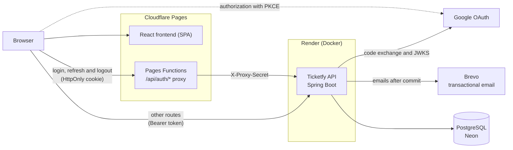

# Ticketfy API

REST API for selling event tickets, built with Java and Spring Boot: from ticket tiers to sales, from QR Code to check-in.

<p align="center">
  <a href="https://ticketfy-6fd.pages.dev"></a>
</p>

<p align="center"><sub><a href="README.md">Ler em português</a></sub></p>

<table>
  <tr>
    <td width="33%"><br><sub>Home page</sub></td>
    <td width="33%"><br><sub>Event and ticket selection</sub></td>
    <td width="33%"><br><sub>Order review</sub></td>
  </tr>
  <tr>
    <td><br><sub>Tickets with QR Code</sub></td>
    <td><br><sub>Organizer dashboard</sub></td>
    <td align="center"><br><sub>On a phone</sub></td>
  </tr>
</table>

<sub>Local frontend with the fictional events from <code>scripts/seed-demo.sh</code> and simulated payment. The interface is shown in Portuguese and is also available in English.</sub>

## About

Selling tickets is easy until two people fight over the last seat, someone double-clicks "pay" or the same QR Code is scanned at two gates. Ticketfy handles these cases in the database, with transactions and locks, for three roles: buyer, organizer and administrator.

## Features

- **Buyer:** search by name, city and category; checkout with coupons and a 15-min reservation; tickets with QR Code and `.ics`; transfers, refunds, Google sign-in and account export or deletion.
- **Organizer:** events, ticket tiers and coupons; check-in and attendee list; sales dashboard; cancellation with automatic refunds; ledger and payouts.
- **Admin:** payout review, account suspension, featured events and audit log.

## Technical highlights

- **Last ticket:** the reservation is a single conditional `UPDATE` on the stock, tested with 10 threads competing for the same tier.
- **Session:** 10-min access token and a rotating refresh token in an `HttpOnly` cookie; token reuse revokes the session (with a 30 s tolerance).
- **Google sign-in:** authorization code with PKCE, code exchanged on the server and `id_token` validated through JWKS.
- **Password reset:** 256-bit, single-use, 30-min token stored only as SHA-256.
- **Emails after commit:** `@TransactionalEventListener(AFTER_COMMIT)` on its own queue; a rolled-back purchase never sends an email.
- **3.6x faster startup:** AppCDS and C1-only JIT cut startup from 516 s to 142 s on 0.1 CPU.

All 27 decisions, with reasoning and consequences, are in the [architecture document](docs/05%20-%20Documento%20de%20Arquitetura.md#9-decisões-arquiteturais) (in Portuguese).

## Stack

**Backend**

| Technology | Version | Used for |
|---|---|---|
|  | 17 | API language |
|  | 4.1.1 | Application base, REST, scheduled jobs |
|  | 7.1.1 | Authentication, roles and session filters |
|  | 4.6.0 | 10-minute JWT access token |
|  | 10.9.1 | Google `id_token` validation |
|  | 3.1.0 | Swagger and `openapi.json` generated at build time |
|  | 3.5.3 | Ticket QR Codes in emails |
|  | 3.9.16 | Build and dependencies |

**Database**

| Technology | Version | Used for |
|---|---|---|
|  | 16 | Relational database (local and tests); Neon in production |
|  | 7.4.5 | Entity mapping (JPA) |
|  | 12.4.0 | Versioned schema migrations |

**Frontend**

| Technology | Version | Used for |
|---|---|---|
|  | 19.3.0 | Website UI |
|  | 8.4.0 | Page routing |
|  | 5.104.0 | API calls and caching |
|  | 7.0.2 | Frontend typing |
|  | 8.3.2 | Dev server and build |
|  | 4.3.3 | Styling |

**Infrastructure and deployment**

| Technology | Version | Used for |
|---|---|---|
|  | — | Multi-stage image with AppCDS, and local Compose |
|  | — | API hosting |
|  | — | Managed PostgreSQL in production |
|  | Wrangler 4.149.0 | Frontend hosting and session proxy Functions |
|  | — | CI, coverage badge and report |

**Testing and quality**

| Technology | Version | Used for |
|---|---|---|
|  | 6.0.3 | 531 API tests |
|  | 2.0.5 | Real PostgreSQL in integration tests |
|  | 0.8.15 | Coverage, with a minimum enforced by the build |
|  | 5.0.3 | Frontend tests |
|  | — | Static security analysis |
|  | — | Weekly dependency updates |

**Integrations**

| Technology | Version | Used for |
|---|---|---|
|  | OAuth 2.0 | Google sign-in (authorization code + PKCE) |
|  | API v3 | Transactional emails with QR Code and `.ics` |

## Architecture



## Quality

531 tests (59 integration test classes on a real PostgreSQL via Testcontainers), 95% coverage, and CI running the tests and minimum coverage on every push, plus CodeQL and Dependabot.

## Running locally

Requires Java 17+ and Docker. Create a `.env` with `DB_PASSWORD` and `JWT_SECRET` (32+ characters) and run:

```bash
docker compose up -d
set -a; source .env; set +a
./mvnw spring-boot:run          # API at http://localhost:8080, Swagger at /swagger-ui/index.html
./mvnw verify                   # tests (needs Docker)
```

For demo data, use an organizer account: `TICKETFY_EMAIL=... TICKETFY_PASSWORD=... scripts/seed-demo.sh`.

<details>
<summary>Environment variables</summary>

| Variable | Purpose |
|---|---|
| `DB_URL`, `DB_USERNAME`, `DB_PASSWORD` | PostgreSQL connection (`DB_PASSWORD` required) |
| `JWT_SECRET` | Access token signing (required) |
| `SPRING_PROFILES_ACTIVE` | `dev` or `prod` profile |
| `PAYOUT_ENCRYPTION_KEY`, `PROXY_SHARED_SECRET` | Encryption of tax ID and Pix key, and the frontend proxy secret (required in `prod`) |
| `CORS_ALLOWED_ORIGINS`, `SITE_BASE_URL` | Allowed frontend origins and the site address used in emails and `.ics` |
| `GOOGLE_CLIENT_ID`, `GOOGLE_CLIENT_SECRET`, `GOOGLE_REDIRECT_URIS` | Google sign-in |
| `BREVO_API_KEY`, `MAIL_FROM_EMAIL`, `MAIL_FROM_NAME` | Email sending (without them, sends are only logged) |
| `LOGIN_*`, `COUPON_*`, `PAYOUT_*` and others | Limits, deadlines and fees, all with defaults |

The full list is in the [Config](docs/05%20-%20Documento%20de%20Arquitetura.md#config) section of the architecture document.

</details>

## Development

Built by me with the help of AI (Claude Code); the decisions, reviews and testing were carried out by me.

## Author

<p>
  
  <a href="mailto:rodrigolutfy.dev@gmail.com"></a>
  <a href="https://github.com/rodrigolutfydev"></a>
</p>

## Links

<p align="center">
  <a href="https://ticketfy-6fd.pages.dev"></a>
  &nbsp;
  <a href="https://github.com/rodrigolutfydev/ticketfy-web"></a>
</p>

| | Link | What you'll find |
|:-:|---|---|
| 🌐 | **[Website](https://ticketfy-6fd.pages.dev)** | Ticketfy live: showcase, checkout, tickets and organizer dashboard. |
| 💻 | **[Frontend repository](https://github.com/rodrigolutfydev/ticketfy-web)** | The React website code, with the session proxy in Pages Functions. |
| 📘 | **[API documentation](docs/API.md)** | Authentication, errors, limits and every endpoint (in Portuguese). |
| 📄 | **[OpenAPI contract](docs/openapi.json)** | Contract generated at build time and checked in CI. |
| 🏛️ | **[Architecture and decisions](docs/05%20-%20Documento%20de%20Arquitetura.md)** | Layers, security, persistence and the 27 decisions with reasoning (in Portuguese). |
| 🧪 | **[Swagger](https://ticketfy-api.onrender.com/swagger-ui/index.html)** | Browse the endpoints in the browser, read-only ("Try it out" runs GET requests only). |
| 🔤 | **[Versão em português](README.md)** | This README in Portuguese. |
