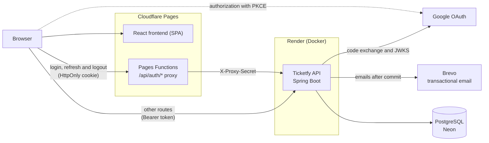
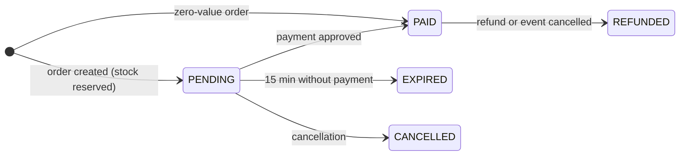

# Ticketfy API

[Português](README.md) · **English**

Ticketing platform for events: buyers find an event, pay and get in with a QR Code on their phone; organizers publish, sell, run check-in and keep track of the money. This repository is the REST API, built with Java and Spring Boot.

[](https://github.com/rodrigolutfydev/Ticketfy-API/actions/workflows/ci.yml)
[](https://rodrigolutfydev.github.io/Ticketfy-API/jacoco/)
[](https://github.com/rodrigolutfydev/Ticketfy-API/actions/workflows/codeql.yml)
[](LICENSE)

**[Website](https://ticketfy-6fd.pages.dev)** · **[Frontend repository](https://github.com/rodrigolutfydev/ticketfy-web)** · **[API reference](docs/API.md)** · **[OpenAPI contract](docs/openapi.json)**

> Swagger UI is turned off in production. It is available when you run the API locally, at `http://localhost:8080/swagger-ui/index.html`.


<table>
  <tr>
    <td width="50%"><br><sub>Event page, with ticket tiers, prices and remaining stock</sub></td>
    <td width="50%"><br><sub>Order review, with coupon and reservation before payment</sub></td>
  </tr>
  <tr>
    <td width="50%"><br><sub>Issued tickets, with QR Code, transfer and add to calendar</sub></td>
    <td width="50%"><br><sub>Organizer dashboard, with sales and revenue per event</sub></td>
  </tr>
</table>

<p align="center"><br><sub>The same event page on a phone</sub></p>

<sub>Screenshots of the frontend running locally against this API, with the fictional events from <code>scripts/seed-demo.sh</code> and simulated payment. The interface is shown in Portuguese; it is also available in English.</sub>

## Contents

- [About](#about)
- [Features](#features)
- [Architecture](#architecture)
- [Stack](#stack)
- [Technical decisions](#technical-decisions)
- [Quality](#quality)
- [Running locally](#running-locally)
- [Documentation](#documentation)
- [Next steps](#next-steps)
- [How it was built](#how-it-was-built)
- [Author and contact](#author-and-contact)

## About

Selling tickets looks simple until two people click the last seat at the same time, a buyer double-clicks "pay", a payment arrives the instant the reservation expires, or the same QR Code is scanned at two gates. Ticketfy handles these cases in the database, with transactions and locks, instead of hoping they never happen.

The system serves three roles:

- **Buyer:** wants to find an event, pay with no surprises and get in with their phone.
- **Organizer:** wants to publish the event, manage ticket tiers and coupons, run check-in and know how much they sold and how much they can withdraw.
- **Administrator:** looks after the platform: reviews payouts, suspends accounts, features events and reads the audit log.

Payment is simulated, behind an interface (`PaymentGateway`) ready for a real provider.

## Features

**Buyer**
- Search by name, city and category, plus a showcase of featured events.
- Buy several ticket tiers in one order, with a discount coupon and a 15-minute reservation.
- Tickets with a QR Code on screen and in the confirmation email, with an `.ics` file for the calendar.
- Transfer a ticket to someone else and request a refund within the deadline.
- Sign in with email and password or with Google, reset the password by email, and use the site in Portuguese or English.
- Export your own data and delete your account.

**Organizer**
- Events, ticket tiers (with per-order and per-buyer limits) and coupons.
- Check-in at the door, attendee list and CSV export.
- Dashboard with revenue, tickets sold, performance per tier and daily sales.
- Event cancellation with automatic refund of orders.
- Balance derived from an immutable ledger, encrypted payout details and payout requests.

**Administrator**
- Review, approve and reject payouts, and block payouts for an organizer.
- Suspend and reactivate accounts.
- Feature events in the showcase.
- Read the audit log of sensitive actions.

## Architecture



The frontend and the API live on different domains, and browsers such as Safari block third-party cookies. That is why the session routes go through a Pages Function on the site's own domain, which forwards the call to the API with a shared secret; the refresh token cookie stays on the site's domain, `HttpOnly` and `SameSite=Strict`. All other routes go straight to the API with a 10-minute access token.

The API is a layered monolith (controller, service, repository), organized by domain (`event`, `order`, `ticket`, `payout`, `auth`, `privacy` and others). The database schema is versioned with Flyway, and rules that must hold even outside the application live in the database itself: `CHECK` constraints, partial unique indexes and triggers that make tables append-only. The full reasoning is in the [architecture document](docs/05%20-%20Documento%20de%20Arquitetura.md) (in Portuguese).

## Stack

| Layer | Technology |
|---|---|
| Language and framework | Java 17, Spring Boot 4.1.1 (Spring Framework 7.0, Spring Security 7.1) |
| Persistence | Hibernate 7.4, Spring Data JPA, PostgreSQL 16, Flyway 12.4 |
| Authentication | java-jwt 4.6.0 (access token), Nimbus JOSE (Google `id_token` validation), BCrypt |
| API documentation | springdoc-openapi 3.1.0 |
| QR Code | ZXing 3.5.3 |
| Tests | JUnit 6.0, Testcontainers 2.0, JaCoCo 0.8.15 |
| Build and delivery | Maven 3.9, multi-stage Docker with AppCDS, GitHub Actions, Render, Neon |
| Integrations | Google OAuth 2.0, Brevo (email) |
| Frontend ([ticketfy-web](https://github.com/rodrigolutfydev/ticketfy-web)) | React 19.3, React Router 8.4, TanStack Query 5, Vite 8.3, TypeScript 7.0, Tailwind CSS 4.3, Cloudflare Pages Functions |

## Technical decisions

Each decision below was checked against the code. The reasoning and consequences of each one are in section 9 of the [architecture document](docs/05%20-%20Documento%20de%20Arquitetura.md#9-decisões-arquiteturais) (in Portuguese).

### Concurrency and money

**Concurrent sale of the last ticket**
- *Problem:* reading the stock and then writing lets two purchases take the same seat.
- *Solution:* the reservation is a single `UPDATE ... WHERE quantity_sold + n <= quantity_total`, which also checks that the event is active, not cancelled and not started yet. If no row changes, the response is 409. A test fires 10 threads at once against the same tier.

**Money as `BigDecimal`**
- *Problem:* `double` accumulates rounding errors in prices, discounts and fees.
- *Solution:* amounts are `BigDecimal` in Java and `NUMERIC(10,2)` in the database, with explicit `HALF_UP` rounding to cents when computing the platform fee.

**Price frozen in the order**
- *Problem:* if the organizer changes a tier's price, existing orders must not change.
- *Solution:* each item stores the unit price at purchase time, and the order stores subtotal, discount, coupon and fee. A test ensures that editing a tier does not change existing orders.

**Order states and 15-minute reservation**
- *Problem:* tickets reserved by someone who gave up on the purchase stay locked forever.
- *Solution:* the order starts as `PENDING` with a 15-minute deadline. A job running every 60 seconds marks overdue orders as `EXPIRED` and gives back the stock and the coupon use.



**Idempotent purchase**
- *Problem:* a double click or a retry after a network failure creates two orders.
- *Solution:* `POST /orders` accepts an `Idempotency-Key` header, backed by a `UNIQUE` constraint in the database. Repeating the key returns the order already created, even when both requests arrive together.

### Security

**Session with rotating refresh token and reuse detection**
- *Problem:* a long-lived JWT stored in the browser can be stolen through XSS and stays valid after logout.
- *Solution:* 10-minute access token and a refresh token in an `HttpOnly` cookie, rotated on every use; the database stores only its SHA-256. Presenting a token that was already used revokes the whole session, with a 30-second tolerance for a request repeated after a network failure. Logout and password change take effect immediately.

**Google sign-in with PKCE**
- *Problem:* accepting an `id_token` coming from the browser allows identity forgery, and the client secret cannot go to the frontend.
- *Solution:* authorization code flow with PKCE; the API exchanges the code with Google using the client secret and validates signature (JWKS), issuer, audience, expiry and verified email.

**Password reset with a token stored only as a hash**
- *Problem:* a database leak must not hand out valid password reset links.
- *Solution:* 256-bit random token, valid for 30 minutes and single use, stored only as SHA-256. The request always answers 202, whether the account exists or not, and the password change ends every session.

**Rate limits**
- *Problem:* brute force on login, coupons, confirmation password and password reset.
- *Solution:* limits per IP, per user or per email, answering 429 with `Retry-After`. The [full table](docs/API.md#limites-de-tentativas) is in the API reference.

### Reliability

**Emails sent only after commit**
- *Problem:* an "order confirmed" email must not leave a transaction that was rolled back, and a slow Brevo must not hold up the purchase.
- *Solution:* the service publishes an event, and an `@TransactionalEventListener(AFTER_COMMIT)` listener sends it on its own bounded queue. A failed send goes to the log and never undoes the operation.

**Errors following RFC 7807**
- *Problem:* each endpoint returning errors in a different shape forces the frontend to parse text.
- *Solution:* every error response is `application/problem+json` with a stable `type`. There are 90 types, published in [`docs/problem-types.json`](docs/problem-types.json), and validation errors carry a `code` and `params` per field so the frontend can translate them.

**Audit log**
- *Problem:* financial and administrative actions need a record of who did what, and that record cannot be erased.
- *Solution:* an `audit_log` table written in the same transaction as the action (`Propagation.MANDATORY`), with the request's `X-Request-Id`. A trigger rejects `UPDATE`, `DELETE` and `TRUNCATE`; the organizer ledger follows the same rule.

### Privacy and performance

**Data export and account deletion (LGPD, Brazil's data protection law)**
- *Problem:* users may ask for their data and for account deletion, but financial records must keep adding up.
- *Solution:* JSON export with password confirmation and a limit of 3 per day; deletion anonymizes the account in a single transaction, locking records in a fixed order so it does not race with purchases and payouts in progress. Retention of financial data still awaits legal review, and the project does not claim compliance with the law.

**3.6x faster startup with AppCDS**
- *Problem:* on Render's free plan (0.1 CPU), the API took minutes to start after sleeping.
- *Solution:* the Docker image build runs a training startup and writes a Class Data Sharing archive (AppCDS); the JVM runs with that archive and only the C1 compiler (`-XX:TieredStopAtLevel=1`).

| Measurement (container with 0.1 CPU and 512 MB, average) | Before | After |
|---|---:|---:|
| Startup | 516 s | 142 s |
| First request | 17.6 s | 6.7 s |
| Memory | ~351 MiB | ~271 MiB |

## Quality

- **608 tests** in 80 classes, all passing (measured on 2026-10-16 with `./mvnw verify`).
- **59 integration test classes** start a real PostgreSQL 16 with Testcontainers, including multi-threaded concurrency tests for stock, coupons, transfers, payouts, sessions and account deletion.
- **95% coverage** (instructions, the badge value), with 95.2% of lines and 81.2% of branches. The build fails below 92% of lines or 78% of branches.

What runs on GitHub Actions:

| When | What runs |
|---|---|
| Push and pull request to `main` | `./mvnw verify`: compilation, all tests and the JaCoCo minimum coverage check |
| Push and pull request to `main` | Check that `openapi.json`, `problem-types.json` and `event-categories.json` in `docs/` match the code |
| Push and pull request to `main` | Test and coverage reports uploaded as an artifact |
| Push to `main` | Coverage badge and report published to GitHub Pages |
| Push, pull request and weekly | Static security analysis with CodeQL |
| Weekly | Dependabot for Maven dependencies and GitHub Actions |

## Running locally

**Prerequisites:** Java 17 or newer and Docker. To load demo data, also `curl` and `jq`.

**1. Set the variables.** Create a `.env` file at the root (it is not versioned) with at least `DB_PASSWORD` and `JWT_SECRET`. `JWT_SECRET` needs 32 or more characters; generate one with `openssl rand -base64 32`.

| Variable | Purpose |
|---|---|
| `SPRING_PROFILES_ACTIVE` | Application profile: `dev` (default when running through Maven) or `prod` |
| `DB_URL`, `DB_USERNAME`, `DB_PASSWORD` | PostgreSQL connection (`DB_PASSWORD` is required) |
| `JWT_SECRET` | Signing key for access tokens (required) |
| `PAYOUT_ENCRYPTION_KEY` | AES-256 key that encrypts tax ID and Pix key (required in `prod`) |
| `PROXY_SHARED_SECRET` | Secret that authenticates the frontend proxy and unlocks the client's real IP (required in `prod`) |
| `CORS_ALLOWED_ORIGINS` | Allowed frontend origins, also checked on the session routes |
| `SITE_BASE_URL` | Frontend address, used in email links and in the `.ics` file |
| `GOOGLE_CLIENT_ID`, `GOOGLE_CLIENT_SECRET`, `GOOGLE_REDIRECT_URIS` | Google sign-in; without them, only that route is unavailable |
| `BREVO_API_KEY`, `MAIL_FROM_EMAIL`, `MAIL_FROM_NAME` | Sending email through Brevo; without them, sends are only logged |
| `MAIL_TIME_ZONE`, `DASHBOARD_TIME_ZONE` | Time zone used in emails and in dashboard grouping |
| `ORDER_RESERVATION_MINUTES`, `REFUND_DEADLINE_HOURS` | Order reservation length and minimum notice for refunds |
| `PLATFORM_FEE_PERCENT` and `PAYOUT_*` | Platform fee and payout rules (minimum, release, review) |
| `LOGIN_*`, `PASSWORD_*`, `COUPON_*`, `DATA_EXPORT_*`, `TICKET_TRANSFER_MAX_PER_TICKET` | Rate and usage limits |

All of them have a default value, except the ones marked as required. The full list, with defaults, is in the Config section of the [architecture document](docs/05%20-%20Documento%20de%20Arquitetura.md#config).

**2. Start the database and the API.**

```bash
git clone https://github.com/rodrigolutfydev/Ticketfy-API.git
cd Ticketfy-API
docker compose up -d                 # PostgreSQL 16
set -a; source .env; set +a
./mvnw spring-boot:run
```

The API starts at `http://localhost:8080`, Flyway creates the tables and Swagger is at `/swagger-ui/index.html`.

To run the API in a container as well, without Java installed, use the Compose `app` profile. It uses the application's `dev` profile, so no production secret is needed:

```bash
docker compose --profile app up -d --build
curl http://localhost:8080/actuator/health
```

**3. Load demo data.** Create an account (through the frontend or `POST /users`), make it an organizer (`POST /users/me/organizer`) and run the script with its credentials. It creates 11 fictional events in several cities, with tiers and prices, using only the HTTP API:

```bash
TICKETFY_EMAIL=your-email TICKETFY_PASSWORD=your-password scripts/seed-demo.sh --dry-run   # only shows the plan
TICKETFY_EMAIL=your-email TICKETFY_PASSWORD=your-password scripts/seed-demo.sh
```

The script can run more than once: events that already exist are skipped. Photos come from `TICKETFY_IMAGE_BASE` (default: the site's `/demo` folder), and `--help` lists the other options.

**4. Run the tests.** Docker must be running, because the tests start a disposable PostgreSQL:

```bash
./mvnw verify
```

`verify` also updates the generated files in `docs/`. If you changed an endpoint, commit `openapi.json` with it, because CI fails when it is out of date.

## Documentation

The documents are written in Portuguese.

**Reference**
- [API reference](docs/API.md): authentication, errors, pagination, idempotency, limits and every endpoint.
- [OpenAPI contract](docs/openapi.json), generated by the build and checked in CI.
- [Error types](docs/problem-types.json) following RFC 7807.

**Architecture and decisions**
- [05 - Architecture Document](docs/05%20-%20Documento%20de%20Arquitetura.md): layers, request flow, security, observability, persistence, the 27 architectural decisions and the known limitations.

**Requirements engineering**
- [01 - Vision Document](docs/01%20-%20Documento%20de%20Vis%C3%A3o.md): problem, goals, audience and scope.
- [02 - Requirements Document](docs/02%20-%20Documento%20de%20Requisitos.md): functional and non-functional requirements, business rules and traceability.
- [03 - Use Case UC01 - Ticket Purchase](docs/03%20-%20Caso%20de%20Uso%20UC01%20-%20Compra%20de%20Ingresso.md): main, alternative and exception flows.
- [04 - Domain Class Diagram](docs/04%20-%20Diagrama%20de%20Classes%20de%20Dom%C3%ADnio.md): classes, attributes and cardinalities.

**Project**
- [Roadmap](docs/ROADMAP.md)

## Next steps

- **Real Pix payments with Asaas**, replacing the simulated payment gateway.
- **Image upload** for profile photos and event covers, today given as an https address.
- **Sentry** for error monitoring in production.
- **Load testing** with k6.

## How it was built

I built Ticketfy with the help of AI (Claude Code); the architecture and product decisions, the code review and the testing were carried out by me.

## Author and contact

**Rodrigo Lutfy**

- GitHub: [@rodrigolutfydev](https://github.com/rodrigolutfydev)
- Email: [rodrigolutfy.dev@gmail.com](mailto:rodrigolutfy.dev@gmail.com)

MIT License. See [LICENSE](LICENSE).
