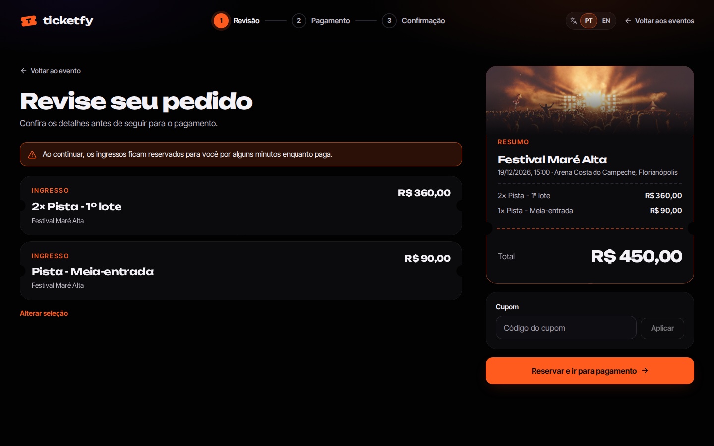
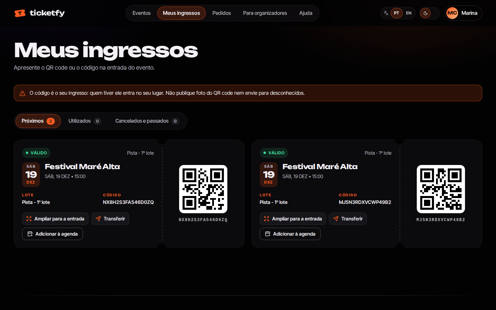
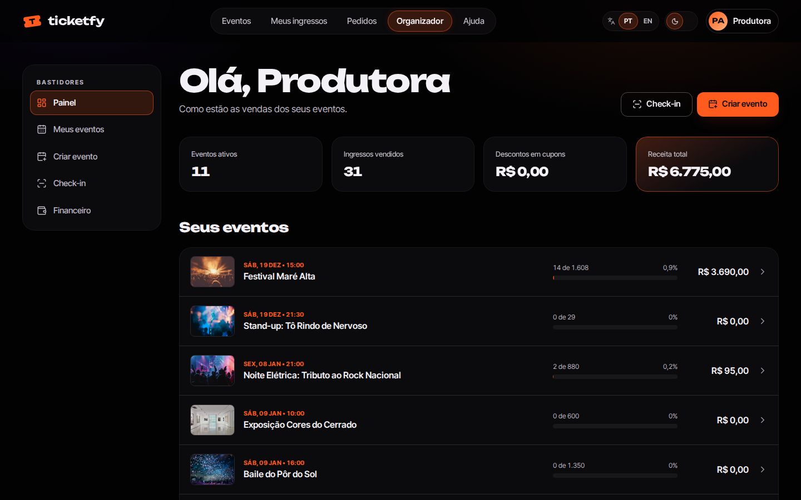
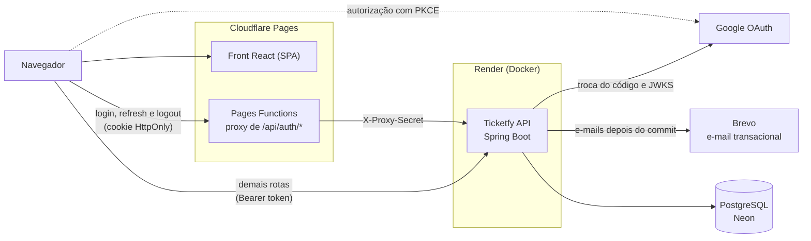

[](https://github.com/rodrigolutfydev/Ticketfy-API/actions/workflows/ci.yml) [](https://rodrigolutfydev.github.io/Ticketfy-API/jacoco/) [](https://github.com/rodrigolutfydev/Ticketfy-API/actions/workflows/codeql.yml) [](LICENSE)

# Ticketfy API

<p>Site: <a href="https://ticketfy-6fd.pages.dev">ticketfy-6fd.pages.dev</a><br><sub><a href="README.en.md">English</a></sub></p>

API REST de venda de ingressos para eventos, desenvolvida em Java com Spring Boot.

<table>
  <tr>
    <td width="33%"><br><sub>Página inicial</sub></td>
    <td width="33%"><br><sub>Evento e escolha de lotes</sub></td>
    <td width="33%"><br><sub>Revisão do pedido</sub></td>
  </tr>
  <tr>
    <td><br><sub>Ingressos com QR Code</sub></td>
    <td><br><sub>Painel do organizador</sub></td>
    <td align="center"><br><sub>Versão mobile</sub></td>
  </tr>
</table>

<sub>Telas do front-end executado localmente, com os eventos fictícios de <code>scripts/seed-demo.sh</code> e pagamento simulado.</sub>

## Sumário

1. [Visão geral](#1-visão-geral)
2. [Funcionalidades](#2-funcionalidades)
3. [Arquitetura](#3-arquitetura)
4. [Tecnologias](#4-tecnologias)
5. [Decisões técnicas](#5-decisões-técnicas)
6. [Qualidade](#6-qualidade)
7. [Execução local](#7-execução-local)
8. [Documentação](#8-documentação)
9. [Autoria](#9-autoria)

## 1. Visão geral

O Ticketfy cobre o ciclo completo da venda de ingressos: publicação do evento, compra, emissão do ingresso com QR Code, check-in e repasse ao organizador. Os casos de concorrência (disputa pelo último ingresso, clique duplo no pagamento, leitura do mesmo ingresso em duas entradas) são tratados no banco de dados, com transações e travas.

## 2. Funcionalidades

| Perfil | Recursos |
|---|---|
| Comprador | Busca por nome, cidade e categoria; compra com cupom e reserva de 15 minutos; ingresso com QR Code e arquivo `.ics`; transferência, reembolso, login com Google, exportação e exclusão da conta |
| Organizador | Eventos, lotes e cupons; check-in e lista de participantes; painel de vendas; cancelamento com reembolso automático; extrato e saques |
| Administrador | Análise de saques, suspensão de contas, destaque de eventos e consulta à auditoria |

## 3. Arquitetura



Monólito em camadas (controller, service, repository) organizado por domínio. As rotas de sessão passam por um proxy no mesmo domínio do site, para que o cookie do refresh token não dependa de cookies de terceiros.

## 4. Tecnologias

| Camada | Tecnologia | Versão | Uso |
|---|---|---|---|
| Backend | Java | 17 | Linguagem da API |
| Backend | Spring Boot | 4.1.1 | Base da aplicação, REST e rotinas agendadas |
| Backend | Spring Security | 7.1.1 | Autenticação, perfis e filtros de sessão |
| Backend | java-jwt | 4.6.0 | Access token JWT |
| Backend | Nimbus JOSE | 10.9.1 | Validação do `id_token` do Google |
| Backend | springdoc-openapi | 3.1.0 | Swagger e contrato `openapi.json` |
| Backend | ZXing | 3.5.3 | QR Code dos ingressos nos e-mails |
| Backend | Maven | 3.9.16 | Build e dependências |
| Banco de dados | PostgreSQL | 16 | Banco relacional (Neon em produção) |
| Banco de dados | Hibernate | 7.4.5 | Mapeamento objeto-relacional (JPA) |
| Banco de dados | Flyway | 12.4.0 | Migrations versionadas |
| Frontend | React | 19.3.0 | Interface do site |
| Frontend | React Router | 8.4.0 | Rotas |
| Frontend | TanStack Query | 5.104.0 | Chamadas à API e cache |
| Frontend | TypeScript | 7.0.2 | Tipagem |
| Frontend | Vite | 8.3.2 | Servidor de desenvolvimento e build |
| Frontend | Tailwind CSS | 4.3.3 | Estilos |
| Infraestrutura | Docker | — | Imagem multi-stage com AppCDS |
| Infraestrutura | Render | — | Hospedagem da API |
| Infraestrutura | Neon | — | PostgreSQL gerenciado |
| Infraestrutura | Cloudflare Pages | Wrangler 4.149.0 | Hospedagem do front e proxy de sessão |
| Infraestrutura | GitHub Actions | — | Integração contínua e relatório de cobertura |
| Testes | JUnit | 6.0.3 | Testes da API |
| Testes | Testcontainers | 2.0.5 | PostgreSQL real nos testes de integração |
| Testes | JaCoCo | 0.8.15 | Cobertura com mínimo exigido no build |
| Testes | Vitest | 5.0.3 | Testes do front |
| Testes | CodeQL e Dependabot | — | Análise de segurança e atualização de dependências |
| Integrações | Google OAuth | 2.0 | Login com Google (authorization code + PKCE) |
| Integrações | Brevo | API v3 | E-mails transacionais com QR Code e `.ics` |

## 5. Decisões técnicas

| Tema | Implementação |
|---|---|
| Venda do último ingresso | Reserva em um único `UPDATE` condicional no estoque, testada com 10 threads disputando o mesmo lote |
| Sessão | Access token de 10 minutos e refresh token rotativo em cookie `HttpOnly`; reuso de token revoga a sessão, com tolerância de 30 segundos |
| Login com Google | Authorization code com PKCE, troca do código no servidor e validação do `id_token` por JWKS |
| Recuperação de senha | Token de 256 bits, uso único e validade de 30 minutos, armazenado apenas como hash SHA-256 |
| E-mails transacionais | Envio após o commit (`@TransactionalEventListener(AFTER_COMMIT)`) em fila própria; transação desfeita não gera e-mail |
| Inicialização | AppCDS e compilação apenas com C1 reduziram a subida de 516 s para 142 s (3,6x) com 0,1 CPU |

As 27 decisões arquiteturais, com motivo e consequência, estão no [documento de arquitetura](docs/05%20-%20Documento%20de%20Arquitetura.md#9-decisões-arquiteturais).

## 6. Qualidade

| Item | Situação |
|---|---|
| Testes | 531, sendo 59 classes de integração com PostgreSQL real via Testcontainers |
| Cobertura | 95% (mínimo exigido no build: 92% de linhas e 78% de desvios) |
| Integração contínua | Testes e cobertura a cada push e pull request; CodeQL e Dependabot |

## 7. Execução local

Pré-requisitos: Java 17 ou superior e Docker. Crie um arquivo `.env` com `DB_PASSWORD` e `JWT_SECRET` (mínimo de 32 caracteres).

```bash
docker compose up -d
set -a; source .env; set +a
./mvnw spring-boot:run          # API em http://localhost:8080
./mvnw verify                   # testes (requer Docker)
```

Dados de demonstração, com uma conta organizadora:

```bash
TICKETFY_EMAIL=... TICKETFY_PASSWORD=... scripts/seed-demo.sh
```

<details>
<summary>Variáveis de ambiente</summary>

| Variável | Finalidade |
|---|---|
| `DB_URL`, `DB_USERNAME`, `DB_PASSWORD` | Conexão com o PostgreSQL (`DB_PASSWORD` obrigatória) |
| `JWT_SECRET` | Assinatura dos access tokens (obrigatória) |
| `SPRING_PROFILES_ACTIVE` | Perfil `dev` ou `prod` |
| `PAYOUT_ENCRYPTION_KEY`, `PROXY_SHARED_SECRET` | Cifra de documento e chave Pix, e segredo do proxy do front (obrigatórias em `prod`) |
| `CORS_ALLOWED_ORIGINS`, `SITE_BASE_URL` | Origens autorizadas e endereço do site usado nos e-mails e no `.ics` |
| `GOOGLE_CLIENT_ID`, `GOOGLE_CLIENT_SECRET`, `GOOGLE_REDIRECT_URIS` | Login com Google |
| `BREVO_API_KEY`, `MAIL_FROM_EMAIL`, `MAIL_FROM_NAME` | Envio de e-mails (sem elas, o envio é apenas registrado no log) |
| `LOGIN_*`, `COUPON_*`, `PAYOUT_*` e outras | Limites, prazos e taxas, todas com valor padrão |

A lista completa está na seção [Config](docs/05%20-%20Documento%20de%20Arquitetura.md#config) do documento de arquitetura.

</details>

## 8. Documentação

### 8.1 Acesso

| Recurso | Descrição |
|---|---|
| [Site](https://ticketfy-6fd.pages.dev) | Aplicação em produção |
| [Swagger](https://ticketfy-api.onrender.com/swagger-ui/index.html) | Endpoints da API em modo somente leitura (o "Try it out" executa apenas GET) |

### 8.2 Referência da API

A [referência da API](docs/API.md) documenta as regras de uso e todos os endpoints, agrupados por assunto.

| Seção | Conteúdo |
|---|---|
| [Autenticação](docs/API.md#autenticação) | Access token, refresh token em cookie, cabeçalhos `Origin` e `X-Ticketfy-Auth`, login com Google, recuperação e confirmação de senha |
| [Erros](docs/API.md#erros) | Formato RFC 7807, códigos de validação por campo, motivos (`reason`) e tabela dos tipos de erro |
| [Formato dos CSVs](docs/API.md#formato-dos-csvs) | Separador, decimais e datas conforme o idioma da conta |
| [Paginação e ordenação](docs/API.md#paginação-e-ordenação) | Parâmetros `page`, `size` e `sort` e formato da resposta paginada |
| [Idempotência](docs/API.md#idempotência) | Uso do cabeçalho `Idempotency-Key` em pedidos e saques |
| [Limites de tentativas](docs/API.md#limites-de-tentativas) | Limites por IP, usuário ou e-mail e respostas 429 |
| [Endpoints](docs/API.md#endpoints) | Usuários e conta, privacidade (LGPD), eventos, lotes, cupons, pedidos e pagamento, ingressos e transferência, participantes, painel e financeiro do organizador, administração e saúde |

Arquivos gerados a partir do código a cada build e conferidos no CI:

| Arquivo | Conteúdo |
|---|---|
| [`openapi.json`](docs/openapi.json) | Contrato OpenAPI 3.1 com 58 rotas e 70 operações |
| [`problem-types.json`](docs/problem-types.json) | Os 90 tipos de erro, com status, título e motivos possíveis |
| [`event-categories.json`](docs/event-categories.json) | As 11 categorias de evento aceitas pela API |

### 8.3 Engenharia

| Documento | Conteúdo |
|---|---|
| [01 - Documento de Visão](docs/01%20-%20Documento%20de%20Vis%C3%A3o.md) | Problema, objetivos, público-alvo e escopo |
| [02 - Documento de Requisitos](docs/02%20-%20Documento%20de%20Requisitos.md) | Requisitos funcionais e não funcionais, regras de negócio e rastreabilidade |
| [03 - Caso de Uso UC01](docs/03%20-%20Caso%20de%20Uso%20UC01%20-%20Compra%20de%20Ingresso.md) | Compra de ingresso: fluxo principal, alternativos e de exceção |
| [04 - Diagrama de Classes de Domínio](docs/04%20-%20Diagrama%20de%20Classes%20de%20Dom%C3%ADnio.md) | Classes, atributos, enums e cardinalidades |
| [05 - Documento de Arquitetura](docs/05%20-%20Documento%20de%20Arquitetura.md) | Camadas, fluxo de uma requisição, segurança, observabilidade, persistência, decisões arquiteturais e limitações |

### 8.4 Projeto

| Documento | Conteúdo |
|---|---|
| [Roadmap](docs/ROADMAP.md) | O que já foi entregue e os próximos passos |
| [English version](README.en.md) | Este documento em inglês |

## 9. Autoria

Desenvolvido por Rodrigo Lutfy para um projeto academico.

Contato: [rodrigolutfy.dev@gmail.com](mailto:rodrigolutfy.dev@gmail.com) · GitHub: [rodrigolutfydev](https://github.com/rodrigolutfydev)
