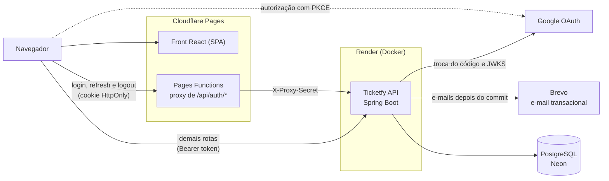

# Ticketfy API

API REST de venda de ingressos para eventos, em Java e Spring Boot: do lote à venda, do QR Code ao check-in.

<p align="center">
  <a href="https://ticketfy-6fd.pages.dev"></a>
</p>

<p align="center"><sub><a href="README.en.md">Read in English</a></sub></p>

<table>
  <tr>
    <td width="33%"><br><sub>Página inicial</sub></td>
    <td width="33%"><br><sub>Evento e escolha de lotes</sub></td>
    <td width="33%"><br><sub>Revisão do pedido</sub></td>
  </tr>
  <tr>
    <td><br><sub>Ingressos com QR Code</sub></td>
    <td><br><sub>Painel do organizador</sub></td>
    <td align="center"><br><sub>No celular</sub></td>
  </tr>
</table>

<sub>Front local com os eventos fictícios do <code>scripts/seed-demo.sh</code> e pagamento simulado.</sub>

## Sobre

Vender ingresso é fácil até duas pessoas disputarem o último lugar, alguém clicar duas vezes em "pagar" ou o mesmo QR Code ser lido em duas portas. O Ticketfy resolve esses casos no banco, com transações e travas, para três perfis: comprador, organizador e administrador.

## Funcionalidades

- **Comprador:** busca por nome, cidade e categoria; compra com cupom e reserva de 15 min; ingresso com QR Code e `.ics`; transferência, reembolso, login com Google e exportação ou exclusão da conta.
- **Organizador:** eventos, lotes e cupons; check-in e lista de participantes; painel de vendas; cancelamento com reembolso automático; extrato e saques.
- **Admin:** análise de saques, suspensão de contas, destaque de eventos e auditoria.

## Destaques técnicos

- **Último ingresso:** a reserva é um único `UPDATE` condicional no estoque, testado com 10 threads disputando o mesmo lote.
- **Sessão:** access token de 10 min e refresh token rotativo em cookie `HttpOnly`; reuso de token revoga a sessão (com 30 s de tolerância).
- **Login com Google:** authorization code com PKCE, código trocado no servidor e `id_token` validado por JWKS.
- **Recuperação de senha:** token de 256 bits, uso único e 30 min, guardado só como SHA-256.
- **E-mails depois do commit:** `@TransactionalEventListener(AFTER_COMMIT)` em fila própria; compra desfeita nunca gera e-mail.
- **Inicialização 3,6x mais rápida:** AppCDS e JIT só C1 levaram a subida de 516 s para 142 s com 0,1 CPU.

As 27 decisões, com motivo e consequência, estão no [documento de arquitetura](docs/05%20-%20Documento%20de%20Arquitetura.md#9-decisões-arquiteturais).

## Stack

**Backend**

| Tecnologia | Versão | Uso no Ticketfy |
|---|---|---|
|  | 17 | Linguagem da API |
|  | 4.1.1 | Base da aplicação, REST, rotinas agendadas |
|  | 7.1.1 | Autenticação, perfis e filtros de sessão |
|  | 4.6.0 | Access token JWT de 10 minutos |
|  | 10.9.1 | Validação do `id_token` do Google |
|  | 3.1.0 | Swagger e `openapi.json` gerado no build |
|  | 3.5.3 | QR Code dos ingressos nos e-mails |
|  | 3.9.16 | Build e dependências |

**Banco de dados**

| Tecnologia | Versão | Uso no Ticketfy |
|---|---|---|
|  | 16 | Banco relacional (local e testes); Neon em produção |
|  | 7.4.5 | Mapeamento das entidades (JPA) |
|  | 12.4.0 | Migrations versionadas do esquema |

**Frontend**

| Tecnologia | Versão | Uso no Ticketfy |
|---|---|---|
|  | 19.3.0 | Interface do site |
|  | 8.4.0 | Rotas das páginas |
|  | 5.104.0 | Cache e chamadas à API |
|  | 7.0.2 | Tipagem do código do front |
|  | 8.3.2 | Servidor de desenvolvimento e build |
|  | 4.3.3 | Estilos |

**Infraestrutura e deploy**

| Tecnologia | Versão | Uso no Ticketfy |
|---|---|---|
|  | — | Imagem multi-stage com AppCDS e Compose local |
|  | — | Hospedagem da API |
|  | — | PostgreSQL gerenciado em produção |
|  | Wrangler 4.149.0 | Hospedagem do front e Functions de proxy da sessão |
|  | — | CI, selo e relatório de cobertura |

**Testes e qualidade**

| Tecnologia | Versão | Uso no Ticketfy |
|---|---|---|
|  | 6.0.3 | 531 testes da API |
|  | 2.0.5 | PostgreSQL real nos testes de integração |
|  | 0.8.15 | Cobertura, com mínimo exigido no build |
|  | 5.0.3 | Testes do front |
|  | — | Análise estática de segurança |
|  | — | Atualização semanal de dependências |

**Integrações**

| Tecnologia | Versão | Uso no Ticketfy |
|---|---|---|
|  | OAuth 2.0 | Login com Google (authorization code + PKCE) |
|  | API v3 | E-mails transacionais com QR Code e `.ics` |

## Arquitetura



## Qualidade

531 testes (59 classes de integração com PostgreSQL real via Testcontainers), 95% de cobertura, e CI com testes e cobertura mínima em todo push, além de CodeQL e Dependabot.

## Como rodar localmente

Requer Java 17+ e Docker. Crie um `.env` com `DB_PASSWORD` e `JWT_SECRET` (32+ caracteres) e rode:

```bash
docker compose up -d
set -a; source .env; set +a
./mvnw spring-boot:run          # API em http://localhost:8080, Swagger em /swagger-ui/index.html
./mvnw verify                   # testes (precisa do Docker)
```

Para dados de demonstração, use uma conta organizadora: `TICKETFY_EMAIL=... TICKETFY_PASSWORD=... scripts/seed-demo.sh`.

<details>
<summary>Variáveis de ambiente</summary>

| Variável | Para que serve |
|---|---|
| `DB_URL`, `DB_USERNAME`, `DB_PASSWORD` | Conexão com o PostgreSQL (`DB_PASSWORD` obrigatória) |
| `JWT_SECRET` | Assinatura dos access tokens (obrigatória) |
| `SPRING_PROFILES_ACTIVE` | Perfil `dev` ou `prod` |
| `PAYOUT_ENCRYPTION_KEY`, `PROXY_SHARED_SECRET` | Cifra de documento e chave Pix, e segredo do proxy do front (obrigatórias em `prod`) |
| `CORS_ALLOWED_ORIGINS`, `SITE_BASE_URL` | Origens do front autorizadas e endereço do site nos e-mails e no `.ics` |
| `GOOGLE_CLIENT_ID`, `GOOGLE_CLIENT_SECRET`, `GOOGLE_REDIRECT_URIS` | Login com Google |
| `BREVO_API_KEY`, `MAIL_FROM_EMAIL`, `MAIL_FROM_NAME` | Envio de e-mails (sem elas, só registra no log) |
| `LOGIN_*`, `COUPON_*`, `PAYOUT_*` e outras | Limites, prazos e taxas, todos com padrão |

A lista completa está na seção [Config](docs/05%20-%20Documento%20de%20Arquitetura.md#config) do documento de arquitetura.

</details>

## Desenvolvimento

Desenvolvido por mim com auxílio de IA (Claude Code); as decisões, revisões e testes foram conduzidos por mim.

## Autor

<p>
  
  <a href="mailto:rodrigolutfy.dev@gmail.com"></a>
  <a href="https://github.com/rodrigolutfydev"></a>
</p>

## Links

<p align="center">
  <a href="https://ticketfy-6fd.pages.dev"></a>
  &nbsp;
  <a href="https://github.com/rodrigolutfydev/ticketfy-web"></a>
</p>

| | Link | O que tem |
|:-:|---|---|
| 🌐 | **[Site](https://ticketfy-6fd.pages.dev)** | O Ticketfy no ar: vitrine, compra, ingressos e painel do organizador. |
| 💻 | **[Repositório do front](https://github.com/rodrigolutfydev/ticketfy-web)** | Código do site em React, com o proxy de sessão em Pages Functions. |
| 📘 | **[Documentação da API](docs/API.md)** | Autenticação, erros, limites e todos os endpoints. |
| 📄 | **[Contrato OpenAPI](docs/openapi.json)** | Contrato gerado no build e conferido no CI. |
| 🏛️ | **[Arquitetura e decisões](docs/05%20-%20Documento%20de%20Arquitetura.md)** | Camadas, segurança, persistência e as 27 decisões com motivo e consequência. |
| 🧪 | **[Swagger](https://ticketfy-api.onrender.com/swagger-ui/index.html)** | Explorar os endpoints no navegador, em modo só leitura (o "Try it out" executa apenas GET). |
| 🔤 | **[English version](README.en.md)** | Este README em inglês. |
