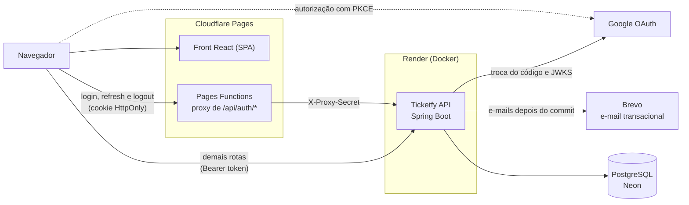
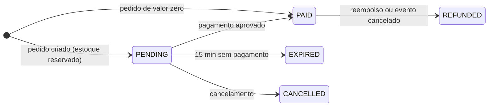

# Ticketfy API

**Português** · [English](README.en.md)

Plataforma de venda de ingressos para eventos: o comprador encontra o evento, paga e entra com o QR Code no celular; o organizador publica, vende, faz o check-in e acompanha o dinheiro. Este repositório é a API REST em Java e Spring Boot.

[](https://github.com/rodrigolutfydev/Ticketfy-API/actions/workflows/ci.yml)
[](https://rodrigolutfydev.github.io/Ticketfy-API/jacoco/)
[](https://github.com/rodrigolutfydev/Ticketfy-API/actions/workflows/codeql.yml)
[](LICENSE)

**[Site](https://ticketfy-6fd.pages.dev)** · **[Repositório do front](https://github.com/rodrigolutfydev/ticketfy-web)** · **[Referência da API](docs/API.md)** · **[Contrato OpenAPI](docs/openapi.json)**

> O Swagger UI fica desligado em produção. Ele está disponível ao rodar a API localmente, em `http://localhost:8080/swagger-ui/index.html`.


<table>
  <tr>
    <td width="50%"><br><sub>Página do evento, com lotes, preço e estoque restante</sub></td>
    <td width="50%"><br><sub>Revisão do pedido, com cupom e reserva antes do pagamento</sub></td>
  </tr>
  <tr>
    <td width="50%"><br><sub>Ingressos emitidos, com QR Code, transferência e agenda</sub></td>
    <td width="50%"><br><sub>Painel do organizador, com vendas e receita por evento</sub></td>
  </tr>
</table>

<p align="center"><br><sub>A mesma página do evento no celular</sub></p>

<sub>Prints do front rodando localmente contra esta API, com os eventos fictícios do <code>scripts/seed-demo.sh</code> e pagamento simulado.</sub>

## Sumário

- [Sobre](#sobre)
- [Funcionalidades](#funcionalidades)
- [Arquitetura](#arquitetura)
- [Stack](#stack)
- [Decisões técnicas](#decisões-técnicas)
- [Qualidade](#qualidade)
- [Como rodar localmente](#como-rodar-localmente)
- [Documentação](#documentação)
- [Próximos passos](#próximos-passos)
- [Sobre o desenvolvimento](#sobre-o-desenvolvimento)
- [Autor e contato](#autor-e-contato)

## Sobre

Vender ingresso parece simples até duas pessoas clicarem no último lugar ao mesmo tempo, o comprador clicar duas vezes em "pagar", o pagamento chegar no instante em que a reserva expira ou o mesmo QR Code ser lido em duas portas. O Ticketfy trata esses casos no banco de dados, com transações e travas, e não com a esperança de que eles não aconteçam.

O sistema atende três perfis:

- **Comprador:** quer achar um evento, pagar sem surpresa e entrar com o celular.
- **Organizador:** quer publicar o evento, controlar lotes e cupons, fazer o check-in e saber quanto vendeu e quanto tem para sacar.
- **Administrador:** cuida da plataforma: analisa saques, suspende contas, destaca eventos e consulta a auditoria.

O pagamento é simulado, atrás de uma interface (`PaymentGateway`) pronta para receber um provedor real.

## Funcionalidades

**Comprador**
- Busca por nome, cidade e categoria, e vitrine de destaques.
- Compra de vários lotes no mesmo pedido, com cupom de desconto e reserva de 15 minutos.
- Ingresso com QR Code na tela e no e-mail de confirmação, com arquivo `.ics` para a agenda.
- Transferência de ingresso para outra pessoa e reembolso dentro do prazo.
- Login com e-mail e senha ou com Google, recuperação de senha por e-mail e site em português e inglês.
- Exportação dos próprios dados e exclusão da conta.

**Organizador**
- Eventos, lotes (com limite por pedido e por comprador) e cupons.
- Check-in na entrada, lista de participantes e exportação em CSV.
- Painel com receita, ingressos vendidos, desempenho por lote e vendas por dia.
- Cancelamento do evento com reembolso automático dos pedidos.
- Saldo derivado de um extrato imutável, dados de recebimento cifrados e pedidos de saque.

**Administrador**
- Análise, aprovação e recusa de saques, e bloqueio de saques de um organizador.
- Suspensão e reativação de contas.
- Destaque de eventos na vitrine.
- Consulta da auditoria das ações sensíveis.

## Arquitetura



O front e a API ficam em domínios diferentes, e navegadores como o Safari bloqueiam cookies de terceiros. Por isso, as rotas de sessão passam por uma Pages Function no mesmo domínio do site, que repassa a chamada para a API com um segredo compartilhado; o cookie do refresh token fica no domínio do site, `HttpOnly` e `SameSite=Strict`. As demais rotas vão direto à API com o access token de 10 minutos.

A API é um monólito em camadas (controller, service, repository), organizado por domínio (`event`, `order`, `ticket`, `payout`, `auth`, `privacy` e outros). O esquema do banco é versionado com Flyway, e regras que precisam valer mesmo fora da aplicação ficam no próprio banco: `CHECK`, índices únicos parciais e triggers que tornam tabelas append-only. O raciocínio completo está no [documento de arquitetura](docs/05%20-%20Documento%20de%20Arquitetura.md).

## Stack

| Camada | Tecnologia |
|---|---|
| Linguagem e framework | Java 17, Spring Boot 4.1.1 (Spring Framework 7.0, Spring Security 7.1) |
| Persistência | Hibernate 7.4, Spring Data JPA, PostgreSQL 16, Flyway 12.4 |
| Autenticação | java-jwt 4.6.0 (access token), Nimbus JOSE (validação do `id_token` do Google), BCrypt |
| Documentação da API | springdoc-openapi 3.1.0 |
| QR Code | ZXing 3.5.3 |
| Testes | JUnit 6.0, Testcontainers 2.0, JaCoCo 0.8.15 |
| Build e entrega | Maven 3.9, Docker multi-stage com AppCDS, GitHub Actions, Render, Neon |
| Integrações | Google OAuth 2.0, Brevo (e-mail) |
| Front ([ticketfy-web](https://github.com/rodrigolutfydev/ticketfy-web)) | React 19.3, React Router 8.4, TanStack Query 5, Vite 8.3, TypeScript 7.0, Tailwind CSS 4.3, Cloudflare Pages Functions |

## Decisões técnicas

Cada decisão abaixo foi conferida no código. O motivo e as consequências de cada uma estão na seção 9 do [documento de arquitetura](docs/05%20-%20Documento%20de%20Arquitetura.md#9-decisões-arquiteturais).

### Concorrência e dinheiro

**Venda concorrente do último ingresso**
- *Problema:* ler o estoque e depois gravar deixa duas compras passarem pelo mesmo lugar.
- *Solução:* a reserva é um único `UPDATE ... WHERE quantity_sold + n <= quantity_total`, que também confere evento ativo, não cancelado e ainda não iniciado. Se nenhuma linha muda, a resposta é 409. Um teste dispara 10 threads ao mesmo tempo contra o mesmo lote.

**Dinheiro em `BigDecimal`**
- *Problema:* `double` acumula erro de arredondamento em preço, desconto e taxa.
- *Solução:* valores em `BigDecimal` no Java e `NUMERIC(10,2)` no banco, com arredondamento explícito `HALF_UP` em centavos no cálculo da taxa da plataforma.

**Preço congelado no pedido**
- *Problema:* se o organizador muda o preço do lote, pedidos já feitos não podem mudar de valor.
- *Solução:* cada item grava o preço unitário do momento da compra, e o pedido grava subtotal, desconto, cupom e taxa. Há teste garantindo que editar o lote não altera pedidos existentes.

**Estados do pedido e reserva de 15 minutos**
- *Problema:* ingresso reservado por quem desistiu da compra fica preso para sempre.
- *Solução:* o pedido nasce `PENDING` com prazo de 15 minutos. Uma rotina a cada 60 segundos marca os vencidos como `EXPIRED` e devolve estoque e uso de cupom.



**Idempotência na compra**
- *Problema:* um clique duplo ou uma nova tentativa depois de falha de rede cria dois pedidos.
- *Solução:* `POST /orders` aceita o header `Idempotency-Key`, protegido por restrição `UNIQUE` no banco. Repetir a chave devolve o pedido já criado, inclusive quando as duas requisições chegam juntas.

### Segurança

**Sessão com refresh token rotativo e detecção de reuso**
- *Problema:* um JWT longo guardado no navegador pode ser roubado por XSS e continua válido depois do logout.
- *Solução:* access token de 10 minutos e refresh token em cookie `HttpOnly`, trocado a cada uso; o banco guarda só o SHA-256 dele. Reapresentar um token já usado revoga a sessão inteira, com tolerância de 30 segundos para a requisição repetida por falha de rede. Logout e troca de senha valem na hora.

**Login com Google com PKCE**
- *Problema:* aceitar um `id_token` vindo do navegador permite forjar identidade, e o client secret não pode ir para o front.
- *Solução:* fluxo authorization code com PKCE; a API troca o código no Google com o client secret e valida assinatura (JWKS), emissor, audiência, validade e e-mail verificado.

**Recuperação de senha com token guardado só como hash**
- *Problema:* um vazamento do banco não pode entregar links válidos de troca de senha.
- *Solução:* token de 256 bits aleatórios, válido por 30 minutos e de uso único, guardado só como SHA-256. O pedido responde sempre 202, exista a conta ou não, e a troca de senha encerra todas as sessões.

**Limites de tentativas**
- *Problema:* força bruta em login, cupom, senha de confirmação e recuperação de senha.
- *Solução:* limites por IP, por usuário ou por e-mail, com 429 e `Retry-After`. A [tabela completa](docs/API.md#limites-de-tentativas) está na referência da API.

### Confiabilidade

**E-mails enviados só depois do commit**
- *Problema:* um e-mail de "compra confirmada" não pode sair de uma transação que depois foi desfeita, e a Brevo lenta não pode travar a compra.
- *Solução:* o serviço publica um evento, e o listener `@TransactionalEventListener(AFTER_COMMIT)` envia numa fila própria e limitada. Uma falha no envio vai para o log e nunca desfaz a operação.

**Erros no padrão RFC 7807**
- *Problema:* cada endpoint devolvendo erro num formato diferente obriga o front a interpretar texto.
- *Solução:* toda resposta de erro é `application/problem+json` com `type` estável. São 90 tipos, publicados em [`docs/problem-types.json`](docs/problem-types.json), e os erros de validação trazem `code` e `params` por campo para o front traduzir.

**Auditoria**
- *Problema:* ações financeiras e administrativas precisam de rastro de quem fez o quê, e o rastro não pode ser apagado.
- *Solução:* tabela `audit_log` gravada na mesma transação da ação (`Propagation.MANDATORY`), com o `X-Request-Id` da requisição. Um trigger recusa `UPDATE`, `DELETE` e `TRUNCATE`; o extrato do organizador segue a mesma regra.

### Privacidade e desempenho

**Exportação de dados e exclusão de conta (LGPD)**
- *Problema:* o titular pode pedir os próprios dados e a exclusão da conta, mas os registros financeiros precisam continuar somando o mesmo.
- *Solução:* exportação em JSON com senha de confirmação e limite de 3 por dia; a exclusão anonimiza a conta numa única transação, travando os registros numa ordem fixa para não disputar com compras e saques em andamento. A retenção dos dados financeiros ainda depende de validação jurídica, e o projeto não afirma conformidade com a lei.

**Inicialização 3,6 vezes mais rápida com AppCDS**
- *Problema:* no plano grátis do Render (0,1 CPU), a API demorava minutos para subir depois de hibernar.
- *Solução:* o build da imagem Docker faz uma inicialização de treino e grava um arquivo de Class Data Sharing (AppCDS); a JVM roda com esse arquivo e só com o compilador C1 (`-XX:TieredStopAtLevel=1`).

| Medição (contêiner com 0,1 CPU e 512 MB, média) | Antes | Depois |
|---|---:|---:|
| Inicialização | 516 s | 142 s |
| Primeira requisição | 17,6 s | 6,7 s |
| Memória | ~351 MiB | ~271 MiB |

## Qualidade

- **608 testes** em 80 classes, todos passando (medido em 16/10/2026 com `./mvnw verify`).
- **59 classes de teste de integração** sobem um PostgreSQL 16 real com Testcontainers, incluindo testes de concorrência com várias threads para estoque, cupom, transferência, saque, sessão e exclusão de conta.
- **Cobertura de 95%** (instruções, valor do selo), com 95,2% das linhas e 81,2% dos desvios. O build falha abaixo de 92% de linhas ou 78% de desvios.

O que roda no GitHub Actions:

| Quando | O que roda |
|---|---|
| Push e pull request para `main` | `./mvnw verify`: compilação, todos os testes e verificação de cobertura mínima do JaCoCo |
| Push e pull request para `main` | Conferência de que `openapi.json`, `problem-types.json` e `event-categories.json` em `docs/` estão atualizados com o código |
| Push e pull request para `main` | Relatórios de teste e de cobertura publicados como artefato |
| Push para `main` | Selo e relatório de cobertura publicados no GitHub Pages |
| Push, pull request e semanalmente | Análise estática de segurança com CodeQL |
| Semanalmente | Dependabot para dependências Maven e GitHub Actions |

## Como rodar localmente

**Pré-requisitos:** Java 17 ou mais recente e Docker. Para popular com dados de demonstração, também `curl` e `jq`.

**1. Configure as variáveis.** Crie um arquivo `.env` na raiz (ele não é versionado) com pelo menos `DB_PASSWORD` e `JWT_SECRET`. O `JWT_SECRET` precisa de 32 ou mais caracteres; gere um com `openssl rand -base64 32`.

| Variável | Para que serve |
|---|---|
| `SPRING_PROFILES_ACTIVE` | Perfil da aplicação: `dev` (padrão ao rodar pelo Maven) ou `prod` |
| `DB_URL`, `DB_USERNAME`, `DB_PASSWORD` | Conexão com o PostgreSQL (`DB_PASSWORD` é obrigatória) |
| `JWT_SECRET` | Chave de assinatura dos access tokens (obrigatória) |
| `PAYOUT_ENCRYPTION_KEY` | Chave AES-256 que cifra documento e chave Pix (obrigatória em `prod`) |
| `PROXY_SHARED_SECRET` | Segredo que autentica o proxy do front e libera o IP real do cliente (obrigatório em `prod`) |
| `CORS_ALLOWED_ORIGINS` | Origens do front autorizadas, também conferidas nas rotas de sessão |
| `SITE_BASE_URL` | Endereço do front, usado nos links dos e-mails e do arquivo `.ics` |
| `GOOGLE_CLIENT_ID`, `GOOGLE_CLIENT_SECRET`, `GOOGLE_REDIRECT_URIS` | Login com Google; sem elas, só essa rota fica indisponível |
| `BREVO_API_KEY`, `MAIL_FROM_EMAIL`, `MAIL_FROM_NAME` | Envio de e-mails pela Brevo; sem elas, o envio só é registrado no log |
| `MAIL_TIME_ZONE`, `DASHBOARD_TIME_ZONE` | Fuso usado nos e-mails e nos agrupamentos do painel |
| `ORDER_RESERVATION_MINUTES`, `REFUND_DEADLINE_HOURS` | Prazo da reserva do pedido e antecedência mínima para reembolso |
| `PLATFORM_FEE_PERCENT` e `PAYOUT_*` | Taxa da plataforma e regras de saque (mínimo, liberação, análise) |
| `LOGIN_*`, `PASSWORD_*`, `COUPON_*`, `DATA_EXPORT_*`, `TICKET_TRANSFER_MAX_PER_TICKET` | Limites de tentativas e de uso |

Todas têm valor padrão, exceto as marcadas como obrigatórias. A lista completa, com os padrões, está na seção Config do [documento de arquitetura](docs/05%20-%20Documento%20de%20Arquitetura.md#config).

**2. Suba o banco e a API.**

```bash
git clone https://github.com/rodrigolutfydev/Ticketfy-API.git
cd Ticketfy-API
docker compose up -d                 # PostgreSQL 16
set -a; source .env; set +a
./mvnw spring-boot:run
```

A API sobe em `http://localhost:8080`, o Flyway cria as tabelas e o Swagger fica em `/swagger-ui/index.html`.

Para rodar a API também em contêiner, sem Java instalado, use o perfil `app` do Compose. Ele usa o perfil `dev` da aplicação, então não precisa de nenhum segredo de produção:

```bash
docker compose --profile app up -d --build
curl http://localhost:8080/actuator/health
```

**3. Popule com dados de demonstração.** Crie uma conta (pelo front ou em `POST /users`), torne-a organizadora (`POST /users/me/organizer`) e rode o script com as credenciais dela. Ele cria 11 eventos fictícios em várias cidades, com lotes e preços, usando só a API HTTP:

```bash
TICKETFY_EMAIL=seu-email TICKETFY_PASSWORD=sua-senha scripts/seed-demo.sh --dry-run   # só mostra o plano
TICKETFY_EMAIL=seu-email TICKETFY_PASSWORD=sua-senha scripts/seed-demo.sh
```

O script pode rodar mais de uma vez: eventos que já existem são pulados. As fotos vêm de `TICKETFY_IMAGE_BASE` (padrão: a pasta `/demo` do site), e `--help` lista as outras opções.

**4. Rode os testes.** O Docker precisa estar rodando, porque os testes sobem um PostgreSQL descartável:

```bash
./mvnw verify
```

O `verify` também atualiza os arquivos gerados em `docs/`. Se você mudou algum endpoint, commite o `openapi.json` junto, porque o CI falha quando ele está desatualizado.

## Documentação

**Referência**
- [Referência da API](docs/API.md): autenticação, erros, paginação, idempotência, limites e todos os endpoints.
- [Contrato OpenAPI](docs/openapi.json), gerado no build e conferido no CI.
- [Tipos de erro](docs/problem-types.json) no padrão RFC 7807.

**Arquitetura e decisões**
- [05 - Documento de Arquitetura](docs/05%20-%20Documento%20de%20Arquitetura.md): camadas, fluxo de uma requisição, segurança, observabilidade, persistência, as 27 decisões arquiteturais e as limitações conhecidas.

**Engenharia de requisitos**
- [01 - Documento de Visão](docs/01%20-%20Documento%20de%20Vis%C3%A3o.md): problema, objetivos, público e escopo.
- [02 - Documento de Requisitos](docs/02%20-%20Documento%20de%20Requisitos.md): requisitos funcionais e não funcionais, regras de negócio e rastreabilidade.
- [03 - Caso de Uso UC01 - Compra de Ingresso](docs/03%20-%20Caso%20de%20Uso%20UC01%20-%20Compra%20de%20Ingresso.md): fluxo principal, alternativos e de exceção.
- [04 - Diagrama de Classes de Domínio](docs/04%20-%20Diagrama%20de%20Classes%20de%20Dom%C3%ADnio.md): classes, atributos e cardinalidades.

**Projeto**
- [Roadmap](docs/ROADMAP.md)

## Próximos passos

- **Pix real com Asaas**, no lugar do gateway de pagamento simulado.
- **Upload de imagem** para foto de perfil e capa de evento, hoje informadas como endereço https.
- **Sentry** para monitoramento de erros em produção.
- **Teste de carga** com k6.

## Sobre o desenvolvimento

O Ticketfy foi desenvolvido por mim com o auxílio de IA (Claude Code); as decisões de arquitetura e de produto, a revisão do código e os testes foram conduzidos por mim.

## Autor e contato

**Rodrigo Lutfy**

- GitHub: [@rodrigolutfydev](https://github.com/rodrigolutfydev)
- E-mail: [rodrigolutfy.dev@gmail.com](mailto:rodrigolutfy.dev@gmail.com)

Licença MIT. Veja [LICENSE](LICENSE).
