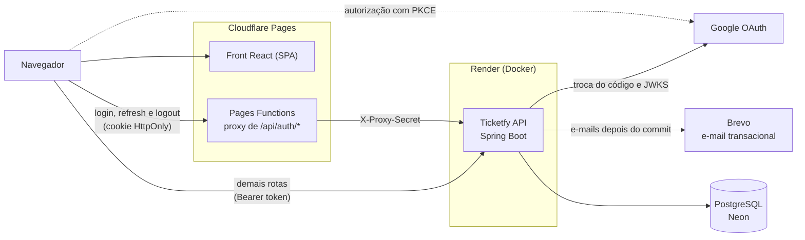

# Ticketfy API

API REST de venda de ingressos para eventos, em Java e Spring Boot: do lote à venda, do QR Code ao check-in.

<p align="center">
  <a href="https://ticketfy-6fd.pages.dev"></a>
</p>

<p align="center"><sub><a href="README.en.md">Read in English</a></sub></p>

<table>
  <tr>
    <td width="33%"><br><sub>Página inicial</sub></td>
    <td width="33%"><br><sub>Evento e escolha de lotes</sub></td>
    <td width="33%"><br><sub>Revisão do pedido</sub></td>
  </tr>
  <tr>
    <td><br><sub>Ingressos com QR Code</sub></td>
    <td><br><sub>Painel do organizador</sub></td>
    <td align="center"><br><sub>No celular</sub></td>
  </tr>
</table>

<sub>Front local com os eventos fictícios do <code>scripts/seed-demo.sh</code> e pagamento simulado.</sub>

## Sobre

Vender ingresso é fácil até duas pessoas disputarem o último lugar, alguém clicar duas vezes em "pagar" ou o mesmo QR Code ser lido em duas portas. O Ticketfy resolve esses casos no banco, com transações e travas, para três perfis: comprador, organizador e administrador.

## Funcionalidades

- **Comprador:** busca por nome, cidade e categoria; compra com cupom e reserva de 15 min; ingresso com QR Code e `.ics`; transferência, reembolso, login com Google e exportação ou exclusão da conta.
- **Organizador:** eventos, lotes e cupons; check-in e lista de participantes; painel de vendas; cancelamento com reembolso automático; extrato e saques.
- **Admin:** análise de saques, suspensão de contas, destaque de eventos e auditoria.

## Destaques técnicos

- **Último ingresso:** a reserva é um único `UPDATE` condicional no estoque, testado com 10 threads disputando o mesmo lote.
- **Sessão:** access token de 10 min e refresh token rotativo em cookie `HttpOnly`; reuso de token revoga a sessão (com 30 s de tolerância).
- **Login com Google:** authorization code com PKCE, código trocado no servidor e `id_token` validado por JWKS.
- **Recuperação de senha:** token de 256 bits, uso único e 30 min, guardado só como SHA-256.
- **E-mails depois do commit:** `@TransactionalEventListener(AFTER_COMMIT)` em fila própria; compra desfeita nunca gera e-mail.
- **Inicialização 3,6x mais rápida:** AppCDS e JIT só C1 levaram a subida de 516 s para 142 s com 0,1 CPU.

As 27 decisões, com motivo e consequência, estão no [documento de arquitetura](docs/05%20-%20Documento%20de%20Arquitetura.md#9-decisões-arquiteturais).

## Stack

Java 17, Spring Boot 4.1.1, Spring Security 7.1, Hibernate 7.4, PostgreSQL 16, Flyway 12.4, JUnit 6, Testcontainers 2.0 e JaCoCo, com Docker, GitHub Actions, Render e Neon. Front em React 19, Vite 8, TypeScript 7 e Tailwind 4 na Cloudflare Pages.

## Arquitetura



## Qualidade

608 testes (59 classes de integração com PostgreSQL real via Testcontainers), 95% de cobertura, e CI com testes e cobertura mínima em todo push, além de CodeQL e Dependabot.

## Como rodar localmente

Requer Java 17+ e Docker. Crie um `.env` com `DB_PASSWORD` e `JWT_SECRET` (32+ caracteres) e rode:

```bash
docker compose up -d
set -a; source .env; set +a
./mvnw spring-boot:run          # API em http://localhost:8080, Swagger em /swagger-ui/index.html
./mvnw verify                   # testes (precisa do Docker)
```

Para dados de demonstração, use uma conta organizadora: `TICKETFY_EMAIL=... TICKETFY_PASSWORD=... scripts/seed-demo.sh`.

<details>
<summary>Variáveis de ambiente</summary>

| Variável | Para que serve |
|---|---|
| `DB_URL`, `DB_USERNAME`, `DB_PASSWORD` | Conexão com o PostgreSQL (`DB_PASSWORD` obrigatória) |
| `JWT_SECRET` | Assinatura dos access tokens (obrigatória) |
| `SPRING_PROFILES_ACTIVE` | Perfil `dev` ou `prod` |
| `PAYOUT_ENCRYPTION_KEY`, `PROXY_SHARED_SECRET` | Cifra de documento e chave Pix, e segredo do proxy do front (obrigatórias em `prod`) |
| `CORS_ALLOWED_ORIGINS`, `SITE_BASE_URL` | Origens do front autorizadas e endereço do site nos e-mails e no `.ics` |
| `GOOGLE_CLIENT_ID`, `GOOGLE_CLIENT_SECRET`, `GOOGLE_REDIRECT_URIS` | Login com Google |
| `BREVO_API_KEY`, `MAIL_FROM_EMAIL`, `MAIL_FROM_NAME` | Envio de e-mails (sem elas, só registra no log) |
| `LOGIN_*`, `COUPON_*`, `PAYOUT_*` e outras | Limites, prazos e taxas, todos com padrão |

A lista completa está na seção [Config](docs/05%20-%20Documento%20de%20Arquitetura.md#config) do documento de arquitetura.

</details>

## Desenvolvimento

Desenvolvido por mim com auxílio de IA (Claude Code); as decisões, revisões e testes foram conduzidos por mim.

## Autor

**Rodrigo Lutfy** · [GitHub](https://github.com/rodrigolutfydev) · [rodrigolutfy.dev@gmail.com](mailto:rodrigolutfy.dev@gmail.com)

## Links

- [Site](https://ticketfy-6fd.pages.dev)
- [Repositório do front](https://github.com/rodrigolutfydev/ticketfy-web)
- [Documentação da API](docs/API.md)
- [openapi.json](docs/openapi.json)
- [Documento de arquitetura](docs/05%20-%20Documento%20de%20Arquitetura.md)
- [English version](README.en.md)
